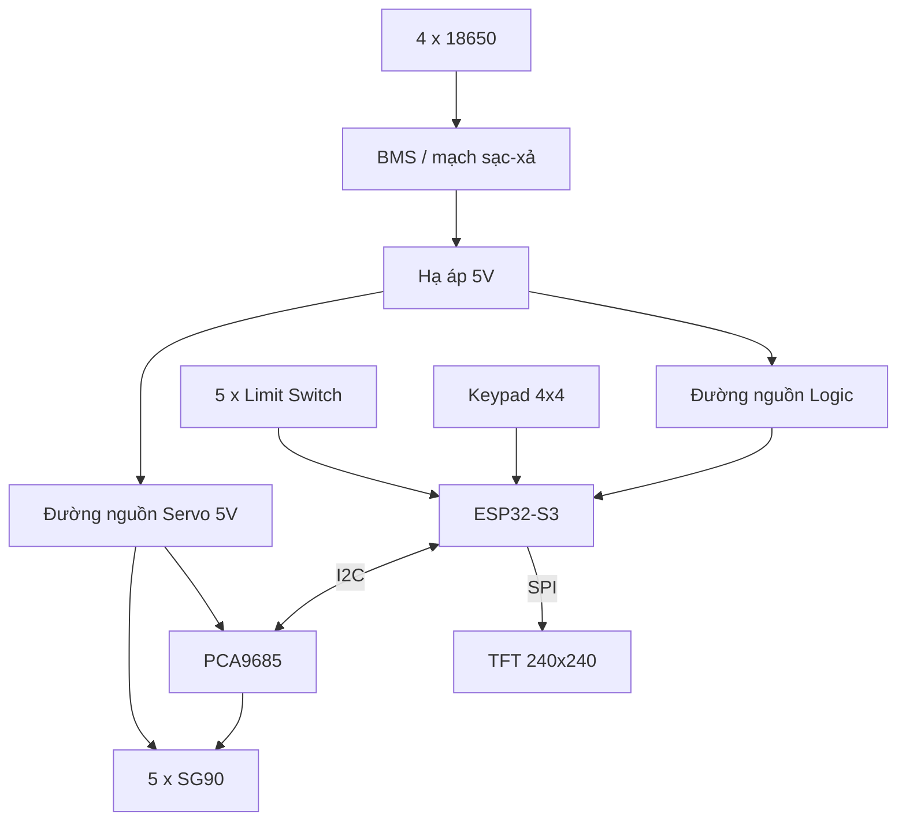
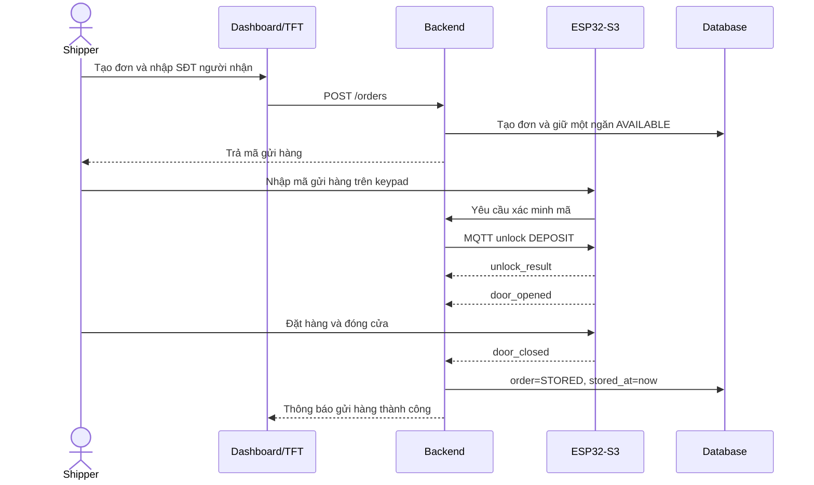
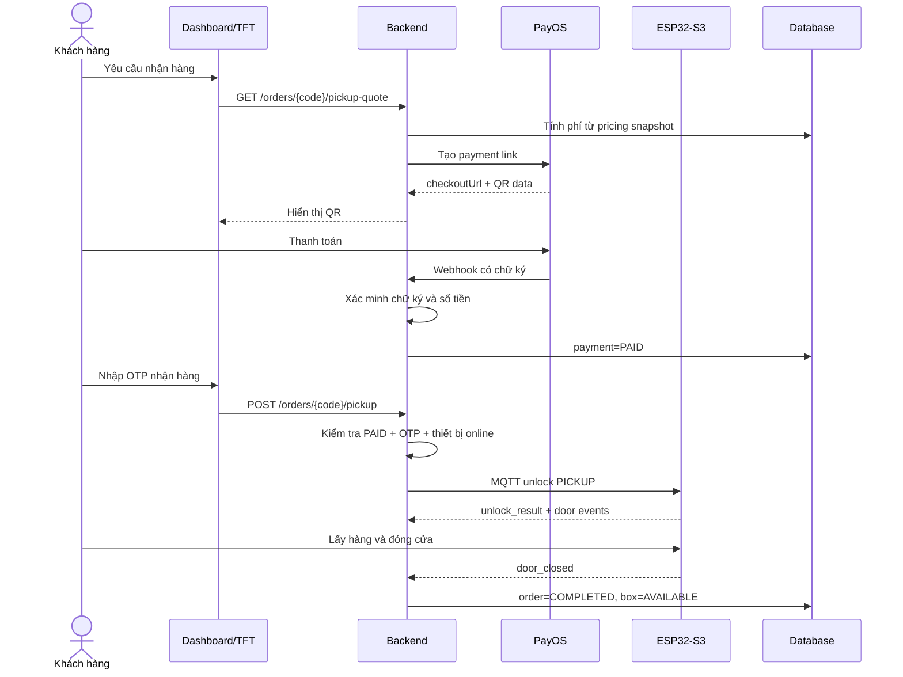

# SmartLocker Phase 1 — Kiến trúc và hướng triển khai

## 1. Mục tiêu tài liệu

Tài liệu này là nguồn thống nhất cho Phase 1 của hệ thống tủ gửi đồ thông minh 5 ngăn. Tài liệu mô tả:

- Phạm vi sản phẩm cần hoàn thành.
- Kiến trúc phần cứng và phần mềm.
- Luồng nghiệp vụ gửi hàng, tính phí, thanh toán MoMo Sandbox và nhận hàng.
- Trạng thái đơn hàng, ngăn tủ và cửa tủ.
- Giao tiếp giữa ESP32-S3 và backend qua MQTT.
- Hành vi an toàn khi mất mạng hoặc mất điện.
- Lộ trình triển khai và tiêu chí nghiệm thu từng mốc.

Tài liệu này thay thế các giả định chưa thống nhất trong những bản mô tả trước. Khi code và tài liệu xung đột, cần cập nhật tài liệu này trước khi thay đổi nghiệp vụ.

---

## 2. Phạm vi Phase 1

### 2.1 Chức năng bắt buộc

Phase 1 phải hoàn thành một hệ thống có thể demo trọn vẹn:

1. Shipper tạo đơn gửi hàng.
2. Backend chọn một ngăn đang trống và cấp mã gửi hàng.
3. Shipper nhập mã trên keypad để mở ngăn.
4. Công tắc hành trình xác nhận quá trình mở và đóng cửa.
5. Khi cửa đóng sau khi gửi hàng, backend ghi nhận `stored_at` và bắt đầu tính phí.
6. Khách hàng xem đơn và số tiền phải trả.
7. Backend tạo payment link và mã QR MoMo Sandbox.
8. Backend xác minh webhook PayOS và chuyển giao dịch sang `PAID`.
9. Khách nhập OTP nhận hàng.
10. Backend kiểm tra thanh toán, OTP và trạng thái thiết bị trước khi ra lệnh mở ngăn.
11. Khi khách lấy hàng và đóng cửa, đơn chuyển sang hoàn thành và ngăn trở lại trạng thái trống.
12. Admin xem trạng thái 5 ngăn và lịch sử thao tác.

### 2.2 Phần cứng Phase 1

- Một board ESP32-S3 điều khiển tủ; model chính xác cần được xác nhận trước khi chốt pin GPIO.
- Một module PCA9685 16 kênh.
- Năm servo SG90.
- Năm công tắc hành trình.
- Một keypad ma trận 4x4, đấu GPIO trực tiếp.
- Một màn hình TFT 240x240 không cảm ứng; driver màn hình cần được xác nhận, dự kiến ST7789.
- Bốn pin 18650, mạch BMS/sạc-xả phù hợp và mạch hạ áp 5V.
- Nguồn servo 5V riêng đủ dòng, nối chung GND với ESP32-S3.

### 2.3 Phần mềm Phase 1

- Firmware: C++ với Arduino Framework và PlatformIO.
- Backend: Python, FastAPI, SQLAlchemy và Alembic.
- Database khi phát triển: SQLite.
- Database khi triển khai: PostgreSQL/Supabase, cấu hình sau.
- Dashboard: Nuxt và TypeScript.
- Giao tiếp thiết bị: MQTT.
- MQTT broker khi phát triển: Mosquitto local.
- Thanh toán: PayOS thật; webhook phải được backend xác minh.
- Wi-Fi Phase 1: ESP32-S3 dùng mạng Wi-Fi có Internet tại nơi demo.

### 2.4 Không thuộc Phase 1

Các hạng mục sau được hoãn sang Phase 2:

- Camera ESP32-S3 N16R8 + OV3660.
- Theo dõi hoặc nhận diện hình ảnh.
- Module LTE/4G A7670C-LANS.
- Tự động chuyển mạng Wi-Fi sang LTE.
- OTA firmware từ xa.
- Ứng dụng di động native.
- Nhiều trạm tủ hoạt động ở nhiều địa điểm.
- Phân tích dữ liệu nâng cao.
- Cơ chế mở tủ offline bằng token đã ký.

---

## 3. Nguyên tắc kiến trúc

1. **Backend quyết định nghiệp vụ**: ESP32 không tự xác nhận thanh toán, không tự tính quyền nhận hàng và không tự quyết định ngăn nào thuộc đơn nào.
2. **ESP32 chịu trách nhiệm phần cứng**: điều khiển servo, đọc công tắc, hiển thị giao diện, nhận keypad và báo cáo trạng thái vật lý.
3. **Thanh toán chỉ được xác nhận qua webhook**: trang `payment/success` không phải bằng chứng thanh toán.
4. **Không đồng nhất trạng thái vật lý và nghiệp vụ**: `door_closed` không có nghĩa là ngăn đang có hàng; `occupied` không chứng minh cửa đang đóng.
5. **Mọi lệnh mở cửa phải có thời hạn và chống thực hiện lặp**.
6. **Mọi thao tác quan trọng phải có audit log**.
7. **Mất mạng phải an toàn**: không mở ngăn nhận hàng khi không xác minh được điều kiện từ backend.
8. **Triển khai từ một ngăn trước**, sau đó mới nhân lên năm ngăn.

---

## 4. Kiến trúc tổng thể

```mermaid
flowchart LR
    User[Shipper / Khách hàng / Admin]
    Dashboard[Dashboard Nuxt]
    Backend[Backend FastAPI]
    DB[(SQLite dev / PostgreSQL prod)]
    PayOS[PayOS]
    Broker[MQTT Broker]
    ESP[ESP32-S3 Locker Controller]
    IO[PCA9685 + 5 Servo\n5 Limit Switch\nKeypad 4x4\nTFT 240x240]

    User --> Dashboard
    Dashboard -->|HTTPS REST| Backend
    Backend --> DB
    Backend -->|Create payment link| MoMo Sandbox
    PayOS -->|Signed webhook| Backend
    Backend <-->|MQTT| Broker
    ESP <-->|MQTT qua Wi-Fi| Broker
    ESP --> IO
```

### 4.1 Trách nhiệm từng thành phần

#### ESP32-S3

- Khởi tạo và kiểm tra ngoại vi.
- Nhận dữ liệu từ keypad.
- Hiển thị hướng dẫn và QR trên TFT.
- Điều khiển PCA9685 và servo.
- Debounce công tắc hành trình.
- Thực hiện state machine cửa.
- Nhận lệnh MQTT hợp lệ từ backend.
- Báo cáo trạng thái, heartbeat và sự kiện cửa.
- Lưu cấu hình và hàng đợi sự kiện nhỏ trong NVS.
- Từ chối lệnh đã xử lý; bổ sung thời hạn lệnh khi nâng giao thức trước production.

#### Backend FastAPI

- Xác thực người dùng và phân quyền.
- Quản lý trạm tủ, ngăn tủ và đơn hàng.
- Chọn ngăn trống và tránh cấp trùng.
- Sinh OTP, chỉ lưu OTP dạng hash.
- Tính phí theo thời gian lưu.
- Tạo payment link MoMo Sandbox qua adapter cổng thanh toán.
- Xác minh chữ ký webhook PayOS.
- Gửi lệnh mở ngăn qua MQTT.
- Nhận sự kiện MQTT và cập nhật database.
- Chống xử lý trùng lệnh và webhook.
- Ghi audit log.

#### Dashboard Nuxt

- Giao diện shipper tạo đơn.
- Giao diện khách xem đơn, phí và QR thanh toán.
- Giao diện admin xem trạng thái tủ và lịch sử.
- Không giữ khóa PayOS, mật khẩu database hoặc MQTT credentials.
- Không tự quyết định trạng thái thanh toán hoặc mở cửa.

#### Database

- Là nguồn dữ liệu chính cho người dùng, đơn hàng, phí và thanh toán.
- Không dùng database làm nguồn trạng thái vật lý tức thời duy nhất; trạng thái cửa được cập nhật từ event MQTT.
- Mọi số tiền lưu bằng số nguyên VND, không dùng `float`.
- Mọi thời gian lưu theo UTC bằng kiểu có timezone; giao diện chuyển sang múi giờ Việt Nam.

---

## 5. Kiến trúc phần cứng



### 5.1 Quy tắc nguồn

- Không cấp năm servo từ chân 5V/3V3 của ESP32-S3.
- Không cho dòng servo đi qua rail breadboard 400 lỗ khi chạy đủ năm servo.
- Nguồn servo và nguồn logic phải nối chung GND.
- Bổ sung tụ lọc gần PCA9685 và đường cấp servo.
- Chỉ cho phép mở một servo tại một thời điểm trong Phase 1 để giảm dòng đỉnh.
- Mạch BMS phải phù hợp với cách ghép bốn cell 18650; không quyết định cấu hình nối tiếp/song song khi chưa có model BMS và bộ sạc cụ thể.

### 5.2 Pin mapping

Pin mapping phải được đặt trong `firmware/include/config/PinConfig.h`. Không ghi cứng GPIO rải rác trong driver.

Chưa chốt pin cho đến khi xác nhận:

- Model board ESP32-S3.
- Driver và pinout TFT.
- Chân boot/strapping và các GPIO không được dùng trên board.
- Công tắc sử dụng tiếp điểm NO hay NC.

---

## 6. Luồng nghiệp vụ chuẩn

### 6.1 Gửi hàng



Điều kiện bắt đầu tính phí là backend nhận được sự kiện cửa đóng hợp lệ sau một phiên gửi hàng đang hoạt động.

### 6.2 Thanh toán và nhận hàng



### 6.3 Công thức phí

Giá không ghi cứng trong firmware. Backend lưu một bản chụp chính sách giá vào đơn lúc bắt đầu gửi:

```text
total_fee = base_fee
          + ceil(max(0, stored_minutes - grace_minutes) / billing_unit_minutes)
            * unit_fee
```

Các giá trị `base_fee`, `grace_minutes`, `billing_unit_minutes` và `unit_fee` được cấu hình phía backend. `total_fee` là số nguyên VND.

---

## 7. Mô hình trạng thái

### 7.1 Trạng thái đơn hàng

```text
CREATED
  -> RESERVED
  -> DEPOSIT_AUTHORIZED
  -> DEPOSIT_OPEN
  -> STORED
  -> PAYMENT_PENDING
  -> PAID
  -> PICKUP_AUTHORIZED
  -> PICKUP_OPEN
  -> COMPLETED
```

Trạng thái kết thúc hoặc xử lý ngoại lệ:

```text
CANCELLED
EXPIRED
MANUAL_REVIEW
```

Quy tắc quan trọng:

- Không chuyển sang `STORED` chỉ vì đã gửi lệnh mở; phải nhận chuỗi sự kiện mở rồi đóng cửa.
- Không chuyển sang `PAID` từ frontend; chỉ webhook PayOS hợp lệ được phép cập nhật.
- Không chuyển sang `COMPLETED` trước khi nhận sự kiện đóng cửa sau khi lấy hàng.

### 7.2 Trạng thái sử dụng ngăn

```text
AVAILABLE
RESERVED
OCCUPIED
OUT_OF_SERVICE
```

Đây là trạng thái do backend quản lý.

### 7.3 Trạng thái vật lý cửa

```text
UNKNOWN
CLOSED_LOCKED
UNLOCKING
OPEN
WAITING_CLOSE
JAMMED
```

Đây là trạng thái do ESP32 quản lý và báo cáo lên backend.

---

## 8. Giao thức MQTT Phase 1

### 8.1 Topic prefix

```text
smartbox/{device_id}/
```

`device_id` là mã duy nhất được cấp cho từng tủ, ví dụ `SB-001`. Không dùng MAC address làm định danh hiển thị cho người dùng.

### 8.2 Topic bắt buộc

| Topic suffix | Hướng | QoS | Retain | Mục đích |
|---|---|---:|---:|---|
| `cmd/unlock` | Backend -> ESP | 1 | No | Mở chốt một ngăn |
| `cmd/set_box` | Backend -> ESP | 1 | No | Đồng bộ cờ đầy/trống xuống ESP |
| `cmd/reboot` | Backend -> ESP | 1 | No | Khởi động lại thiết bị |
| `cmd/request_status` | Backend -> ESP | 0 | No | Yêu cầu snapshot |
| `evt/unlock_result` | ESP -> Backend | 1 | No | Kết quả lệnh mở chốt |
| `evt/set_box_result` | ESP -> Backend | 1 | No | Kết quả đồng bộ đầy/trống |
| `evt/reboot_ack` | ESP -> Backend | 1 | No | Xác nhận trước khi reboot |
| `evt/door` | ESP -> Backend | 1 | No | Sự kiện cửa mở/đóng |
| `status/boxes` | ESP -> Backend | 0 | Yes | Trạng thái 5 ngăn |
| `status/heartbeat` | ESP -> Backend | 0 | Yes | Telemetry định kỳ theo API spec |
| `status/availability` | ESP -> Backend | 1 | Yes | `online` hoặc Last Will `offline` |

`status/availability` là phần mở rộng tương thích để phát hiện offline. Lệnh
`set_box` chỉ đồng bộ một bản sao trạng thái xuống ESP; backend/database vẫn là
nguồn dữ liệu nghiệp vụ chính.

### 8.3 Payload mở ngăn

```json
{
  "box": 0,
  "request_id": "req_abc123"
}
```

Đây là payload tương thích `API_SPECIFICATION.md`. Trước khi public Internet,
giao thức sẽ được nâng phiên bản để bổ sung `order_id`, `purpose`, `issued_at`
và `expires_at` mà không phá vỡ MVP hiện tại.

### 8.4 Quy tắc xử lý lệnh

- ESP kiểm tra `request_id` và chỉ số ngăn.
- ESP lưu cache các `request_id` đã xử lý và request gần nhất trong NVS để QoS 1 không mở cửa hai lần.
- `unlock_result.success=true` chỉ có nghĩa servo đã thực hiện thao tác; không có nghĩa cửa đã mở thực tế.
- Backend chờ `evt/door` để xác nhận trạng thái vật lý.
- Lệnh điều khiển không được retained.
- `status/boxes` và heartbeat được retained theo API spec. Backend không dùng heartbeat retained làm bằng chứng online duy nhất.
- Broker dùng Last Will retained tại `status/availability`.

### 8.5 Bảo mật MQTT

Khi phát triển local, Mosquitto có thể chạy trong LAN riêng. Trước khi public Internet phải có:

- TLS.
- Username/password hoặc certificate riêng cho từng thiết bị.
- ACL giới hạn thiết bị chỉ được subscribe/publish đúng prefix của mình.
- Không dùng `allow_anonymous true` trên broker public.

---

## 9. HTTP API Phase 1

Đây là API của backend FastAPI, không phải web server cấu hình local trên ESP32.

### 9.1 Nhóm endpoint dự kiến

```text
POST   /api/v1/auth/login
POST   /api/v1/orders
GET    /api/v1/orders/{order_code}
POST   /api/v1/orders/{order_code}/deposit/authorize
GET    /api/v1/orders/{order_code}/pickup-quote
POST   /api/v1/orders/{order_code}/payments
POST   /api/v1/orders/{order_code}/pickup
POST   /api/v1/webhooks/payos
GET    /api/v1/lockers/{locker_id}/status
POST   /api/v1/admin/boxes/{box_id}/unlock
GET    /api/v1/admin/audit-logs
```

API chi tiết sẽ được tách sang `API_SPECIFICATION.md` sau khi hoàn thành milestone backend đầu tiên.

### 9.2 Quy tắc API

- Không trả OTP dạng rõ sau khi OTP đã được phát hành.
- Giới hạn số lần nhập sai OTP và khóa tạm thời khi vượt ngưỡng.
- Endpoint webhook PayOS phải xác minh chữ ký trước khi ghi database.
- Kiểm tra `orderCode`, số tiền và trạng thái hiện tại khi nhận webhook.
- Webhook phải idempotent; nhận cùng một dữ liệu nhiều lần không tạo nhiều payment.
- Mở tủ thủ công phải yêu cầu quyền admin, lý do và audit log.

---

## 10. Mô hình dữ liệu tối thiểu

### 10.1 Bảng chính

- `users`: tài khoản shipper, khách hàng và admin.
- `locker_stations`: thông tin một trạm tủ.
- `compartments`: năm ngăn và trạng thái nghiệp vụ.
- `orders`: người gửi, người nhận, ngăn, trạng thái và thời gian.
- `pickup_credentials`: OTP hash, thời hạn, số lần thử và trạng thái sử dụng.
- `pricing_snapshots`: chính sách giá áp dụng cho từng đơn.
- `payments`: nhà cung cấp, mã giao dịch, số tiền, trạng thái và thời điểm thanh toán.
- `payment_webhook_events`: dữ liệu phục vụ chống xử lý trùng và điều tra lỗi.
- `device_commands`: lệnh MQTT, hạn lệnh và kết quả.
- `door_events`: lịch sử trạng thái cửa.
- `device_heartbeats`: lần cuối thiết bị online.
- `audit_logs`: thao tác nghiệp vụ và quản trị.

### 10.2 Ràng buộc quan trọng

- `users.phone` unique sau khi chuẩn hóa số điện thoại.
- `compartments(locker_id, number)` unique.
- `payments.payos_order_code` unique.
- `device_commands.request_id` unique.
- `payment_webhook_events.event_key` unique.
- Chỉ một đơn hoạt động được gắn với một ngăn tại cùng thời điểm.
- OTP lưu bằng hash có salt/pepper phù hợp, không lưu plaintext.

### 10.3 Chiến lược database

- Milestone local dùng SQLite để không bị chặn bởi hạ tầng.
- Mọi truy cập đi qua SQLAlchemy repository/service, không viết logic phụ thuộc SQLite.
- Alembic quản lý migration ngay từ migration đầu tiên.
- Khi Supabase sẵn sàng, đổi connection string sang PostgreSQL và chạy migration.

---

## 11. Xử lý mất mạng và khởi động lại

### 11.1 Mất Wi-Fi hoặc Internet

ESP vẫn thực hiện:

- Đọc công tắc cửa.
- Hoàn tất thao tác cửa đang diễn ra.
- Báo tại chỗ khi cửa mở quá lâu.
- Ghi sự kiện chưa gửi vào hàng đợi NVS có giới hạn.
- Thử kết nối lại với exponential backoff và jitter.
- Gửi lại sự kiện theo `event_id` khi kết nối phục hồi.

ESP không thực hiện:

- Tự xác nhận thanh toán khi chưa có IPN hợp lệ.
- Mở ngăn cho giao dịch mới cần xác minh backend.
- Thực hiện lại lệnh MQTT có `request_id` đã xử lý.

### 11.2 Backend hoặc broker mất kết nối

- Dashboard hiển thị thiết bị offline dựa trên Last Will và `last_seen_at`.
- Backend không cấp lệnh mở mới cho thiết bị offline.
- Đơn đang gửi/nhận dở được chuyển sang trạng thái cần đối soát nếu không xác định được kết quả vật lý.
- Admin không được sửa thẳng database để bỏ qua state machine.

### 11.3 Mất điện

- Cơ cấu khóa phải mặc định ở trạng thái khóa an toàn.
- Khi khởi động lại, ESP đọc toàn bộ công tắc trước khi nhận lệnh mới.
- ESP publish boot event và snapshot đầy đủ.
- Backend đối chiếu snapshot với đơn hoạt động; mọi sai lệch chuyển sang `MANUAL_REVIEW`.

### 11.4 Nâng cấp Phase 2

Phase 2 có thể bổ sung:

- A7670C-LANS để dự phòng 4G.
- DS3231 để giữ thời gian khi mất mạng và khởi động lại.
- FRAM để lưu hàng đợi sự kiện có độ bền ghi cao.

---

## 12. Cấu trúc mã nguồn đề xuất

```text
SmartLocker/
├── PHASE1_ARCHITECTURE.md
├── README.md
├── firmware/
│   ├── platformio.ini
│   ├── include/
│   │   └── config/
│   │       ├── PinConfig.h
│   │       ├── NetworkConfig.h
│   │       └── SystemConfig.h
│   ├── src/
│   │   ├── core/
│   │   ├── devices/
│   │   ├── display/
│   │   ├── network/
│   │   └── storage/
│   └── test/
├── backend/
│   ├── app/
│   │   ├── api/
│   │   ├── core/
│   │   ├── domain/
│   │   ├── infrastructure/
│   │   ├── mqtt/
│   │   └── payments/
│   ├── migrations/
│   └── tests/
├── dashboard/
│   ├── app/
│   └── tests/
└── infrastructure/
    ├── mosquitto/
    └── docker-compose.yml
```

---

## 13. Lộ trình triển khai

### Milestone 0 — Chốt phần cứng và giao thức

Việc thực hiện:

- Xác nhận model ESP32-S3 và TFT.
- Chốt pin mapping không xung đột.
- Xác định NO/NC của limit switch.
- Chốt sơ đồ nguồn và BMS.
- Đồng bộ `API_SPECIFICATION.md` với giao thức MQTT trong tài liệu này.

Tiêu chí hoàn thành:

- Có sơ đồ nối dây được kiểm tra.
- Có danh sách pin chính thức.
- Không còn hai định nghĩa topic MQTT khác nhau.

### Milestone 1 — Proof-of-concept một ngăn

Việc thực hiện:

- ESP32 kết nối Wi-Fi và Mosquitto local.
- Điều khiển một SG90 qua PCA9685.
- Đọc và debounce một công tắc.
- Python/backend gửi lệnh `unlock` có `request_id`.
- ESP gửi `unlock_result` và sự kiện cửa.

Tiêu chí hoàn thành:

- Chạy liên tục ít nhất 50 chu kỳ mở/đóng không reset.
- Lệnh QoS 1 gửi trùng không làm servo mở lần thứ hai.
- Request gần nhất vẫn không bị thực thi lại sau khi ESP reboot.
- Sự kiện cửa đúng thứ tự và không rung giả vượt ngưỡng cho phép.

### Milestone 2 — Nhân lên năm ngăn

Việc thực hiện:

- Kích hoạt năm kênh servo và năm công tắc.
- Không cho mở đồng thời nhiều servo.
- Thêm self-test khi khởi động.
- Thêm phát hiện timeout và `JAMMED`.

Tiêu chí hoàn thành:

- Mỗi lệnh chỉ tác động đúng ngăn được yêu cầu.
- Một ngăn lỗi không làm bốn ngăn còn lại mất hoạt động.
- Nguồn ổn định khi thử liên tục.

### Milestone 3 — Backend nghiệp vụ local

Việc thực hiện:

- FastAPI + SQLite + Alembic.
- Mô hình dữ liệu tối thiểu.
- Tạo đơn và phân ngăn giao dịch an toàn.
- OTP hash, giới hạn số lần thử.
- MQTT worker và audit log.
- Công thức phí với pricing snapshot.

Tiêu chí hoàn thành:

- Test tự động bao phủ các chuyển trạng thái hợp lệ và không hợp lệ.
- Không thể cấp cùng một ngăn cho hai đơn hoạt động.
- Restart backend không làm mất đơn hoặc thực thi lại lệnh đã hoàn tất.

### Milestone 4 — Keypad và TFT

Việc thực hiện:

- Driver keypad 4x4.
- Driver TFT theo đúng controller.
- Màn hình idle, nhập mã, loading, hướng dẫn cửa, QR và lỗi.
- Timeout quay lại màn hình idle.

Tiêu chí hoàn thành:

- Có thể hoàn tất luồng gửi và nhận mà không cần Serial Monitor.
- Không hiển thị OTP đầy đủ trong log.
- Giao diện không treo khi MQTT mất kết nối.

### Milestone 5 — PayOS thật

Việc thực hiện:

- Adapter tạo payment link MoMo Sandbox; Phase 2 có thể chuyển sang payOS.
- Endpoint webhook có xác minh chữ ký.
- Kiểm tra đúng `orderCode` và số tiền.
- Idempotency cho webhook.
- Tunnel HTTPS hoặc backend public để kiểm thử webhook thật.

Tiêu chí hoàn thành:

- Thanh toán thành công cập nhật đúng một lần.
- Truy cập trực tiếp `payment/success` không làm đơn thành `PAID`.
- Webhook sai chữ ký hoặc sai số tiền bị từ chối và audit.
- Chỉ đơn `PAID` với OTP hợp lệ mới mở được ngăn.

### Milestone 6 — Dashboard và kiểm thử tích hợp

Việc thực hiện:

- Dashboard shipper, khách hàng và admin.
- Trạng thái thiết bị, ngăn, đơn và thanh toán.
- Bộ test luồng end-to-end.
- Kịch bản mất mạng, mất điện và cửa kẹt.

Tiêu chí hoàn thành:

- Demo trọn luồng gửi -> tính phí -> PayOS -> OTP -> nhận hàng.
- Dashboard và trạng thái vật lý cuối cùng khớp nhau.
- Có audit log đủ để giải thích mỗi lần mở cửa.

### Milestone 7 — Triển khai cloud

Thực hiện sau khi phần local ổn định:

- Dashboard lên Vercel.
- Backend lên dịch vụ chạy lâu dài như Railway/Render/VPS.
- PostgreSQL trên Supabase.
- MQTT broker có TLS.
- Trỏ `app.<domain>` và `api.<domain>` tại Mắt Bão.
- Đưa secrets vào biến môi trường của nền tảng triển khai.

---

## 14. Kế hoạch kiểm thử tối thiểu

### 14.1 Happy path

- Shipper tạo đơn, gửi hàng và đóng cửa.
- Hệ thống ghi nhận thời gian lưu.
- Khách thanh toán đúng số tiền.
- Webhook hợp lệ cập nhật `PAID`.
- OTP đúng mở đúng ngăn.
- Đóng cửa kết thúc đơn và giải phóng ngăn.

### 14.2 Trường hợp lỗi

- Mã gửi hàng sai hoặc hết hạn.
- OTP sai nhiều lần.
- Thanh toán thiếu hoặc sai mã đơn.
- Webhook gửi lặp.
- Lệnh MQTT gửi lặp.
- Lệnh mở trùng `request_id`.
- Công tắc rung hoặc hỏng.
- Cửa không đóng trong thời gian cho phép.
- ESP mất Wi-Fi giữa quá trình thao tác.
- Backend restart khi đơn đang hoạt động.
- Mất điện rồi khởi động lại với một cửa đang mở.

### 14.3 Kiểm thử an toàn

- Không có khóa bí mật trong source code hoặc frontend bundle.
- MQTT public không cho anonymous access.
- Admin manual unlock luôn có lý do và audit.
- Không thể thay đổi số tiền từ trình duyệt để mở tủ.
- Không thể dùng lại OTP sau khi đơn hoàn thành.

---

## 15. Definition of Done cho Phase 1

Phase 1 được xem là hoàn thành khi đồng thời đạt các điều kiện:

- Cả năm ngăn hoạt động ổn định với servo và công tắc thật.
- Shipper tạo được đơn và gửi hàng từ đầu đến cuối.
- Thời gian lưu và số tiền được backend tính đúng.
- PayOS thật được xác minh bằng webhook.
- Khách chỉ mở được đúng ngăn sau khi thanh toán và nhập OTP hợp lệ.
- Lệnh hoặc webhook gửi lặp không tạo tác dụng lặp.
- Mất mạng không làm tủ tự mở hoặc mất trạng thái quan trọng.
- Dashboard hiển thị trạng thái thiết bị, đơn và thanh toán.
- Có audit log cho mọi lần mở cửa.
- Có hướng dẫn đấu nối, cài đặt, chạy thử và demo.

---

## 16. Các quyết định còn mở

Trước Milestone 1 cần xác nhận:

1. Model chính xác của ESP32-S3 dùng làm controller chính.
2. Controller và pinout của TFT 240x240.
3. Loại tiếp điểm NO/NC của công tắc hành trình.
4. Cấu hình pack pin 18650, model BMS và công suất mạch hạ áp.
5. Cơ cấu khóa thực tế: servo chỉ nhả ngàm hay phải quay lại để khóa.
6. Có lắp buzzer trong Phase 1 hay chỉ cảnh báo trên TFT.
7. Kênh gửi OTP thật: SMS, Zalo OA, email hay hiển thị trong dashboard khi demo.
8. Biểu phí cụ thể và thời gian miễn phí.

Những quyết định này phải được đưa vào file cấu hình hoặc database, không ghi cứng rải rác trong firmware.
